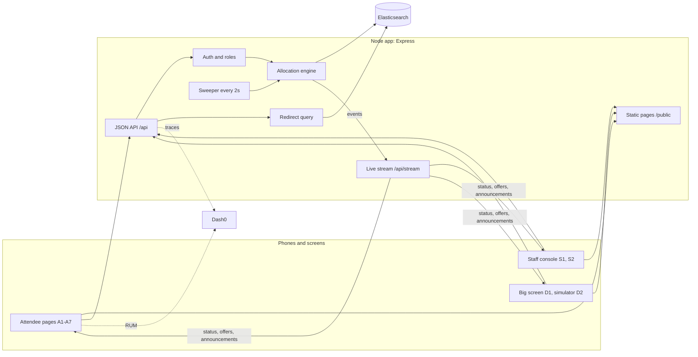

# RightRoom architecture and division of labour

Nov 9, 2026. Draft for the team. It uses the recommended answers to D1 to D15 and the auth decision (username and password with roles); anything Hitesh changes in #general wins over this page. Screen IDs (A1, S2, ...) are from `docs/journey-map.md`.

## Shape of the system

One Node process serves everything: the pages, the JSON API, a live update stream and a background sweeper. Elasticsearch holds all state. OpenTelemetry sends server traces to Dash0, and a browser RUM snippet sends page timings there too.

Why this shape:

- No frontend build step. Pages are plain HTML, one shared CSS file (the design system tokens) and small scripts. Every teammate can edit a page without a toolchain.
- One process means the live stream can be an in-memory list of open connections. Shortcut: this breaks with more than one instance; run exactly one replica for the demo.
- Elasticsearch is the only store, so there is one place to look when a number is wrong.

## Stack

Already in `package.json`: Express 5, `@elastic/elasticsearch`, `@opentelemetry/auto-instrumentations-node`, `dotenv`. Nothing else is needed for the Musts. Password hashing uses Node's built-in `crypto.scrypt`; sessions use a signed cookie via Node's `crypto.createHmac`.

Known fix before anything else (P4): `dotenv` is never loaded and the `DASH0_*` variables are never mapped to the `OTEL_EXPORTER_OTLP_*` names the auto-instrumentation reads, so no traces reach Dash0 today.

## Code layout

| Path | Holds | Owner |
|---|---|---|
| `server.js` | Loads `.env`, mounts routes, starts the sweeper | P2 |
| `src/es.js` | Elasticsearch client, index names, mappings, `ensureIndexes()` | P1 |
| `src/engine.js` | Room status rule, queue, offers, claim, pass-on, release, check-in | P2 |
| `src/redirect.js` | The one redirect query and its "Why this?" reasons | P1 |
| `src/auth.js` | Sign-up, login, guest handle, role check middleware | P2 |
| `src/stream.js` | Server-sent events: subscribe by space, publish events | P2 |
| `src/routes/*.js` | Thin HTTP handlers that call the engine | P2 |
| `public/*.html`, `public/app.js` | Screens A1 to A7, S1, S2, D1, D2 | P3 |
| `public/rr.css` | Design system tokens and components | P3 |
| `public/rum.js` | Dash0 browser monitoring snippet | P4 |
| `scripts/seed.js` | Event, spaces, sessions with embeddings, stand-in queue | P1 |
| `scripts/loadtest.js` | 50 people try for 5 seats; asserts exactly 5 winners | P2 |
| `.github/workflows/ci.yml`, `.gitar/review/` | Lint, load test, Gitar rules | P4 |

## Data (Elasticsearch indexes)

Every document carries `event_id` (one event today).

| Index | Key fields | Written by |
|---|---|---|
| `spaces` | type (venue, room), floor, capacity, `taken`, `status`, rule text, priorities, accessibility seats, zones, walking times, topic embedding | Organiser setup, engine |
| `queue` | space, handle, position, arrival time, needs (step-free, captions), status, reason text, device ID, admission expiry (venue) | Engine |
| `offers` | space, handle, zone, `held_until`, status (Offered, Claimed, Expired, Passed on), claim code | Engine, sweeper |
| `checkins` | space, handle, zone, time; deleted when the session ends | Engine |
| `sessions` | title, abstract, embedding, room, start, end, tags | Seed script |
| `announcements` | text, floor, urgency, time | Organiser |
| `users` | handle, password hash and salt, role, interest tags, needs | Auth |
| `wifi_readings` (Extra) | room, zone, download Mbps, latency ms, time | A6 |

## The rules that must never break

These are where the hackathon is won or lost. P2 owns them and the load test proves them.

1. A seat is never given twice. Making an offer reserves the seat first: one scripted update on the `spaces` document adds 1 to `taken` only while `taken < capacity` (a single-document update, so concurrent requests can't both pass). Claiming then changes only the `offers` document, with `if_seq_no` and `if_primary_term`, from Offered to Claimed, and only if `held_until` is still in the future. Writes use `refresh: wait_for`. A failed claim leaves the person in the queue.
2. Offers expire. The sweeper runs every 2 seconds, marks offers past `held_until` as Expired, and hands the reserved seat to the next person in queue order (accessibility fit first for accessibility seats) without releasing it in between. With nobody left in the queue it subtracts 1 from `taken`.
3. Redirects never send more people than there are free seats. Open offers are already counted in `taken` (rule 1), so free seats are `capacity - taken`. The redirect query only returns rooms where that covers everyone being redirected there at that moment, and the engine reserves those places as offers.
4. Room status follows the rule in `docs/journey-map.md`. The count is automatic: check-ins plus any staff correction plus held offers. Seats free under 80 percent, Filling from 80 percent, Full at capacity, all pushed straight away. Only when a staff console is open for that room does Full wait for the staff member's answer, up to 30 seconds. Redirects start once Full is pushed.
5. Interests never decide who gets a seat. They only rank redirect suggestions.
6. Checking in settles seats, not queues. It cancels the person's offers and claims in other rooms and checks them out of any other room (whose seat then goes to that room's queue), but leaves their place in other queues so they can wait for a better session while seated (journey-map decision 34).

## API contract

Freeze this first so P2 and P3 can build in parallel. P3 can mock any endpoint by returning the example JSON until P2's version lands.

| Method and path | Who | Used on | Returns |
|---|---|---|---|
| `POST /api/signup`, `POST /api/login`, `POST /api/logout` | Anyone | A1 | `{handle, role}` and a cookie |
| `POST /api/guest` | Anyone from a room QR | A5, A6 | Guest handle and cookie |
| `GET /api/me`, `PUT /api/me` | Signed in | A2 | Handle, interests, needs |
| `GET /api/event`, `POST /api/event/register` | Attendee | A3 | Venue status and my queue entry with position and reason |
| `GET /api/sessions` | Anyone | A4 | Sessions with room status and Wi-Fi median |
| `GET /api/floors` | Anyone (staff and organiser get extra fields) | A4 map view, S2 floor map, S1 venue board, D1 | Rooms grouped by floor: id, title, capacity, taken, status, access note; staff and organiser also get staff on door and queue length |
| `GET /api/search?q=&floor=&stepFree=&free=&soon=&mine=&status=&limit=` | Anyone (`mine` needs sign-in; staff and organiser get staff on door and queue length) | A4 search, S1 | `{source, query, results: [{room, sessionTitle, floor, status, taken, capacity, free, stepFree, access, startsAt, risk, why[], score}], took}` |
| `GET /api/heat?room=<id>` | Anyone (no handles) | A4 map, S1 board, S2 | `{room, source: 'elasticsearch'\|'memory', zones: [{zone, crowd: {count, density 0..1, band: quiet\|busy\|packed}, wifi: {mbps, ms, count, band: good\|ok\|weak} \| null}], updatedAt}`; always all 9 zones |
| `/api/floors` tiles (added fields) | Anyone | A4, S1, S2 | `wifiStats: {mbps, ms, count, band, source} \| null` and `heat: {busiest: {zone, density, band} \| null, weakestWifi: {zone, mbps, band} \| null}`; the old `wifi` number stays |
| `GET /api/wifi` (added fields) | Anyone | S1 | per room and zone: `mbps, ms, count, last, band` plus the old `readings`; `source` is `elasticsearch` when it came from there |
| `POST /api/sim/zone-checkins {space, zone, n}`, `POST /api/sim/wifi {space, zone, mbps, ms}` | Staff | `scripts/stage-heat.js` | Stand-in check-ins in one zone; one stand-in Wi-Fi reading |
| `GET /api/forecast`, `GET /api/forecast/backtest` | Anyone | A4, S1 | Fill forecast per session (expected fill, chance it fills, likely minute, risk, the 3 past talks it is based on); leave-one-out backtest. Stand-in, mounted at /api once Phase 1 lands |
| `GET /api/wifi` | Anyone | A4, A6, S1 | Wi-Fi medians by room and zone over `db().wifi` (stand-in plus readings posted to `POST /api/spaces/:id/wifi`). Mounted at /api once Phase 1 lands |
| `GET /api/sessions/:room/topics` | Anyone | A4, A6, S1 | Top 1 to 3 word topics over `db().comments` (comments are posted to `POST /api/spaces/:id/comments`; hidden ones skipped). Mounted at /api once Phase 1 lands |
| `GET /api/insights/interests` | Organiser | S1 | Interest counts, groups under 5 hidden. Stand-in, mounted at /api once Phase 1 lands |
| `GET /api/metrics` | Anyone | S1, demo | Redirect success rate and staff override rate. Stand-in, mounted at /api once Phase 1 lands |
| `GET /api/tables`, `GET /api/alerts`, `GET /api/team-finder` | Anyone | Extras | Stand-in data for tables, saved-need alerts and the team finder. Mounted at /api once Phase 1 lands |
| `GET /api/spaces/:id` | Anyone | A5, D1 | Capacity, taken, status, zone fill, rule |
| `POST /api/spaces/:id/queue` | Attendee or guest | A5 | My position and reason |
| `GET /api/spaces/:id/redirect` | Attendee or guest | A5 | Suggestion, reasons, rejected options with reasons, something different, overflow |
| `POST /api/offers/:id/claim` | The offered handle | A5 | Claimed with zone and code, or why not |
| `POST /api/spaces/:id/checkin` | Attendee or guest | A6 | Checked in, zone |
| `POST /api/spaces/:id/leave` | Attendee or guest | A6 | "I'm leaving": checked out, seat offered to the queue |
| `DELETE /api/spaces/:id/queue` | Attendee or guest | A5 | Left the queue |
| `POST /api/spaces/:id/wifi`, `GET`/`POST /api/spaces/:id/comments` | Signed in | A6 (Extras) | Wi-Fi reading and room median; comment topics |
| `POST /api/staff/spaces/:id/count` | Staff | S2 | New total after `{delta}` |
| `POST /api/staff/spaces/:id/override` | Staff | S2 | Status after "full" or "not full" |
| `POST /api/staff/spaces/:id/release` | Staff | S2 | Offers created for `{n, zone}` |
| `GET /api/staff/spaces/:id` | Staff | S2 | Room view plus correction, who is on the door, queue with claim codes |
| `POST /api/staff/spaces/:id/console` | Staff | S2 | `{action: open\|leave}`: staff on or off this door |
| `POST /api/staff/spaces/:id/confirm` | Staff | S2 | `{answer: full\|not_yet, n, zone}`: answer to "Room looks full, confirm?" |
| `PUT /api/staff/spaces/:id` | Organiser | S1 | Updated capacity, rule, priorities |
| `GET /api/announcements`, `POST /api/announcements` | Anyone, organiser | A7, S1 | Announcements |
| `GET /api/stream?space=:id` | Anyone | All live screens | Server-sent events |
| `POST /api/ack` | Any page | All live screens | `{event_id}`: the server times delivery on its own clock (SLO 1) |
| `POST /api/sim/checkins`, `/sim/queue`, `/sim/rush`, `/sim/end-session`, `/sim/reset` | Staff (reset: organiser) | D2 | Stand-in check-ins and queue, the 50-for-5 load test, end a session, reset the mock |

Live events on `/api/stream`: `status` (space, taken, capacity, status), `position` (handle, position, reason), `offer` (offer ID, zone, seconds left), `offer_passed`, `announcement`. Each event carries the server timestamp so the browser can report delivery time to Dash0 for SLO 1.

## Search

`GET /api/search` (`src/search.js`) runs one hybrid query on P1's sessions index when `ELASTICSEARCH_URL` is set: a `multi_match` on title, tags and abstract (fuzzy) plus a `semantic` query on the `topic` field when semantic search is on, combined in a `bool.should`. Each hit is joined with the live room state (status, free seats, risk from the forecast), then the filters for floor, step-free, free seats, starting soon, status and "my interests" apply. If Elasticsearch is not configured or fails, the same filters run over an in-memory text match on the live rooms. Every result carries `why`, the reasons it matched, so search explains itself like every other decision. Interests are only a filter, never a ranking signal.

## Wi-Fi and zone heatmap

Wi-Fi readings (`src/wifi.js`) go into memory as before and, with `ELASTICSEARCH_URL` set, are also indexed into P1's `wifi_readings` index (no handle; an outage there never fails the request). Per room and per zone summaries (median speed and latency, count, last reading, band: good from 25 Mbps, ok from 8, weak below) come from a terms plus percentiles aggregation there, cached for 30 seconds, or from memory. The zone heatmap (`src/heat.js`) adds crowd density per zone: check-ins per zone over the zone's share of seats (capacity / 9 until zones define seats), banded quiet, busy (from 0.4) and packed (from 0.85). With Elasticsearch on, check-ins are mirrored every 5 seconds into P1's `checkins` index as anonymous docs (hashed ids, no handle) and the crowd comes from an aggregation there; a session ending clears them. `scripts/stage-heat.js [BASE_URL] [--es] [--reset]` stages a believable heatmap for every room of the current venue, read from `/api/floors`.

## Mock insights

Forecast, Wi-Fi, topics, interests and metrics run on stand-in data until the Elasticsearch versions land. Every response carries `source`: `"stand-in"`, or `"mixed"` once real Wi-Fi readings or comments have been posted, so screens can label them. `seedInto(store.db)` in `src/mock/insights-seed.js` appends the stand-in readings and comments to Phase 1's `db().wifi` and `db().comments` using the same record shapes; call it again after `store.reset()`.

- Forecast (`src/forecast.js`): for a session, find the 5 most similar past talks in `src/mock/history.js` (shared tags, morning or afternoon slot, room size, next to a keynote or not), then report the weighted fill, the chance it fills, the likely minute it fills and a risk band. The 3 closest talks are returned as the reason. The backtest predicts each of the 40 past talks from the other 39.
- Topics (`src/topics.js`) score 1 to 3 word phrases in a session's comments against all comments, the way `significant_text` does.
- `src/insights.js` gives Wi-Fi medians by room and zone, interest counts with groups under 5 hidden, and the redirect success and override rates from an event log.

P1's Elasticsearch queries (`significant_text`, aggregations) replace `src/topics.js` and `src/insights.js` behind the same routes.

## Proof (Dash0)

| What | How |
|---|---|
| Traces end to end | Auto-instrumentation on the server; the RUM snippet on every page links browser spans to server spans |
| SLO 1: updates reach phones within 10 seconds | Server stamps each event; the page records receipt time as a RUM timing; SLO on the gap |
| SLO 2: anyone turned away is offered a seat within 30 seconds, accessibility seats never lost | Span from "Full at door" to "offer or redirect shown"; counter for accessibility seats given to people without that need (must stay 0) |
| Redirect success rate | Redirected people who check in to the suggested room within 15 minutes, over all redirects |
| Staff override rate | "Not full" overrides over Full events |
| Load test | `scripts/loadtest.js` in CI and live in the demo: 50 claims for 5 seats, exactly 5 winners |
| Agent0 finding | From the real check-in rush during the demo |

Every number on screen is labelled Live, Real or Stand-in.

## Division of labour

Owner names are a proposal until Hitesh confirms D1 in #general.

| Part | Proposed owner | Builds | Done when |
|---|---|---|---|
| P1 Elasticsearch and data | Varad | `src/es.js` mappings, `scripts/seed.js` with real sessions and embeddings, `src/redirect.js`, staff aggregations | Seed runs on a clean cluster; redirect returns a room with reasons for a full room |
| P2 Backend | Raj | `src/engine.js`, `src/auth.js`, `src/stream.js`, routes, sweeper, `scripts/loadtest.js` | Load test passes; an offer passes on after 60 seconds; status pushes to a phone |
| P3 Frontend, accessibility, design system | Hitesh | `public/rr.css` design system, all screens, axe and VoiceOver passes | The hero path works on a phone with VoiceOver; axe clean |
| P4 Infra, observability, demo | Revanth | Fix Dash0 env mapping, public URL, RUM, both SLOs, Agent0, CI and Gitar, QR codes, README with AI disclosure, recorded backup | A judge's request shows end to end in Dash0; both SLOs on a dashboard |

Hand-offs that block someone else:

| From | To | What | Needed by |
|---|---|---|---|
| P1 | P2 | Index names and mappings in `src/es.js` | 1:45 |
| P2 | P3 | API contract above agreed as-is, plus example JSON per endpoint | 1:45 |
| P4 | Everyone | Public URL and first trace in Dash0 | 2:00 |
| P3 | Everyone | `public/rr.css` tokens and the big-button components | 2:15 |
| P1 | P2 | Redirect query callable from the engine | 3:00 |

## Timeline to submission

| Time | Goal | Done when |
|---|---|---|
| 1:30 to 2:00 | Contract frozen, indexes created, public URL, traces flowing | A request shows in Dash0 |
| 2:00 to 3:00 | Queue, offer, claim, pass-on, check-in, room status live | A released seat is claimed on a phone; a room flips to Full |
| 3:00 to 3:45 | Redirect with "Why this?", venue registration, staff console | A full room redirects with reasons |
| 3:45 to 4:30 | Load test, both SLOs, RUM, axe and VoiceOver pass | 50 to 5 passes; SLOs on screen |
| 4:30 to 5:00 | Demo runs twice on phones, recorded backup, README | Two clean runs |
| 5:00 to 5:15 | Submit | Submitted |

Extras start only after the 3:45 checkpoint passes, in this order: zone map with Wi-Fi, then venue-door scan.

If a Must is at risk at a checkpoint, whoever is on an Extra joins that Must's owner.
